# Multi-Market

Marketplace donde varias tiendas publican sus productos y los clientes arman un carrito y envían pedidos a cada tienda (el pago y la entrega se coordinan con la tienda, p. ej. por WhatsApp).

- `backend/`: API Django REST (JWT/Token, SQLite por defecto).
- `frontend/`: SPA Vue 3 (vue-cli, vuex, vue-router).
- `docs/PLAN.md`: plan de mejoras y estado.
- `docs/PLAN-FRONT.md`: plan de rediseño del frontend y pagos (Mercado Pago).

## Qué incluye

- **Catálogo público:** portada con ofertas y categorías, búsqueda con filtros, ficha con galería, páginas de tienda.
- **Carrito y checkout por pasos** sin cuenta; un pedido por tienda; precios y stock calculados en el servidor.
- **Pagos por tienda:** Mercado Pago (Checkout Pro, modelo marketplace), transferencia con comprobante, efectivo/retiro y link de pago propio (Ualá Bis, MODO, etc.). Comisión de la plataforma configurable (0 % por defecto).
- **Seguimiento de pedidos** por enlace, con confirmación de pago automática (Mercado Pago) o manual (resto).
- **Alta de tiendas** (`/registro`) con aprobación manual desde `/admin/`.
- **Panel de la tienda:** resumen, productos (varias imágenes, stock, descuentos), pedidos, perfil público y cobros.

## Pagos

| Medio | Cómo funciona |
|---|---|
| **Mercado Pago** | Cada tienda conecta su cuenta por OAuth; se crea una preferencia con el token del vendedor (+ `marketplace_fee`). El webhook valida la firma `x-signature` y **consulta el pago a la API** antes de marcar el pedido como pagado. Los tokens se guardan cifrados. |
| **Transferencia** | Se muestran alias/CBU; el comprador sube el comprobante y la tienda confirma. |
| **Efectivo / retiro** | Sin pasarela; la tienda confirma el cobro. |
| **Link de pago** | La tienda define su link `https://` (Ualá Bis, MODO, PayPal.me…). |

> **Mercado Pago está implementado según la documentación oficial y probado con respuestas simuladas** (tests de OAuth, preferencia, webhook, firma, idempotencia y montos). **Todavía no se validó contra el sandbox real** porque no hay credenciales: al tenerlas, definí `MP_CLIENT_ID`, `MP_CLIENT_SECRET`, `MP_WEBHOOK_SECRET` y `BACKEND_PUBLIC_URL` (https) y probá con usuarios de prueba antes de cobrar.

## Vista rápida

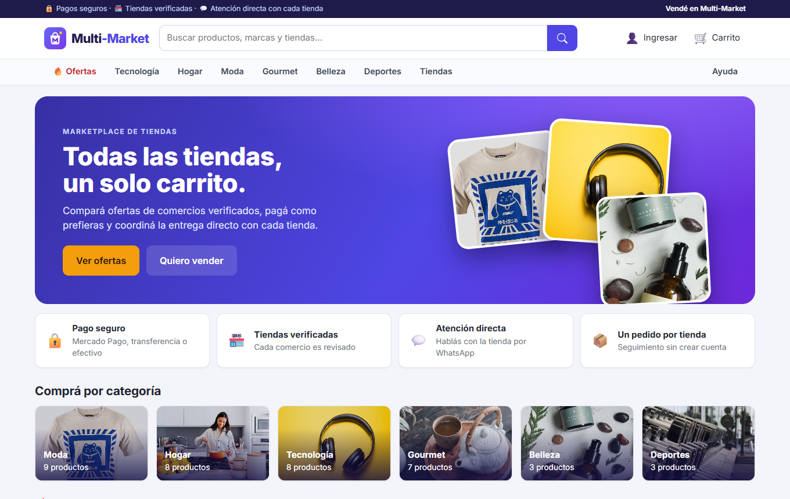

### Para compradores

| Ofertas y filtros | Ficha de producto con galería |
|---|---|
| 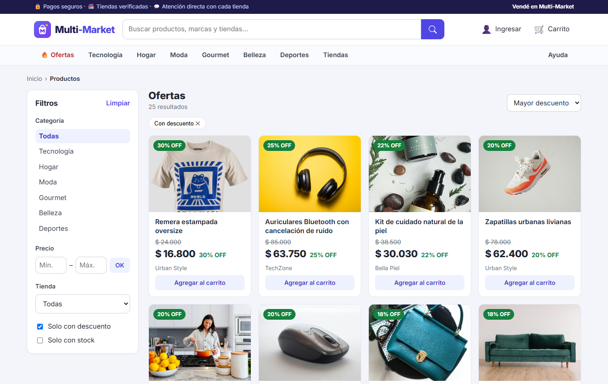 | 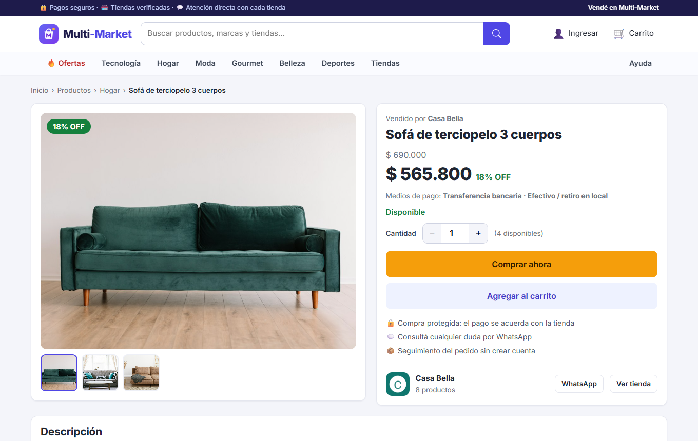 |
| Filtros por categoría, precio, tienda, descuento y stock; orden y paginación. | Varias fotos, precio con descuento, stock, medios de pago de la tienda y **Comprar ahora**. |

| Carrito lateral | Checkout por pasos |
|---|---|
| 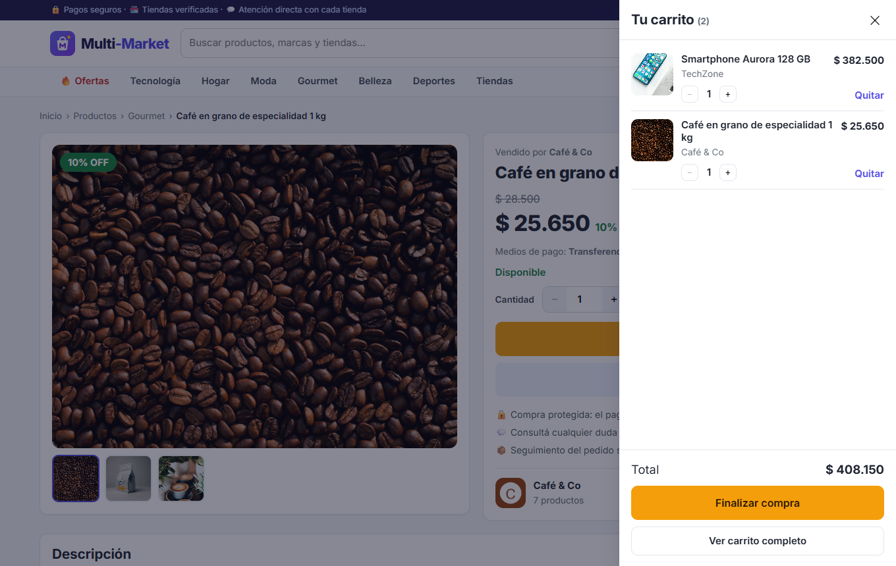 | 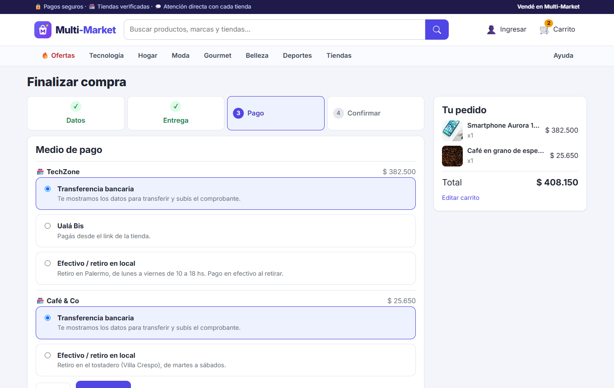 |
| Se abre al agregar un producto; agrupa por tienda. | Datos → entrega → pago → confirmar. Cada tienda ofrece sus propios medios de pago. |

| Seguimiento del pedido (sin cuenta) | Página de una tienda |
|---|---|
| 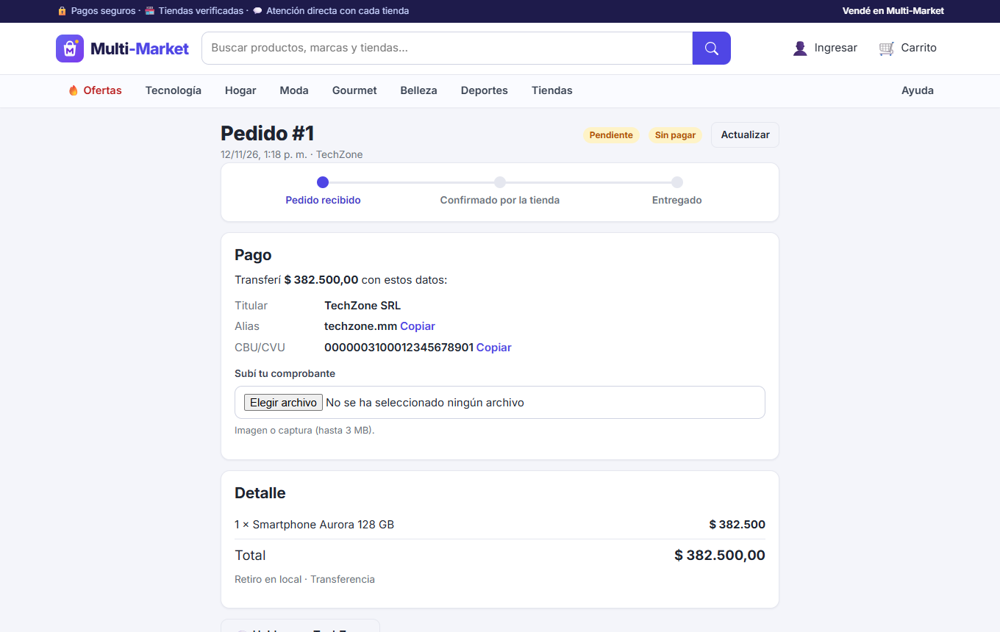 | 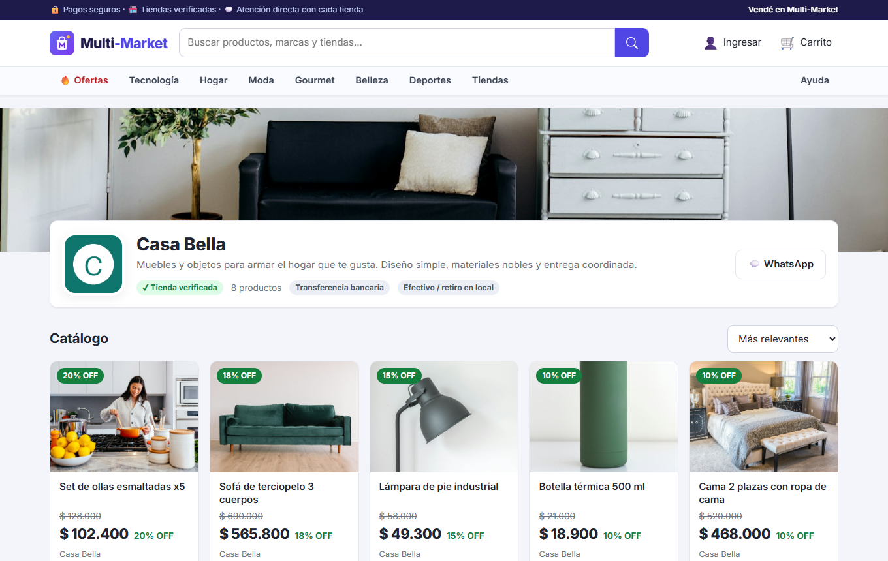 |
| Estado, datos para transferir y subida de comprobante. | Logo, banner, descripción, medios de pago y catálogo propio. |

### Para tiendas

| Resumen | Pedidos |
|---|---|
| 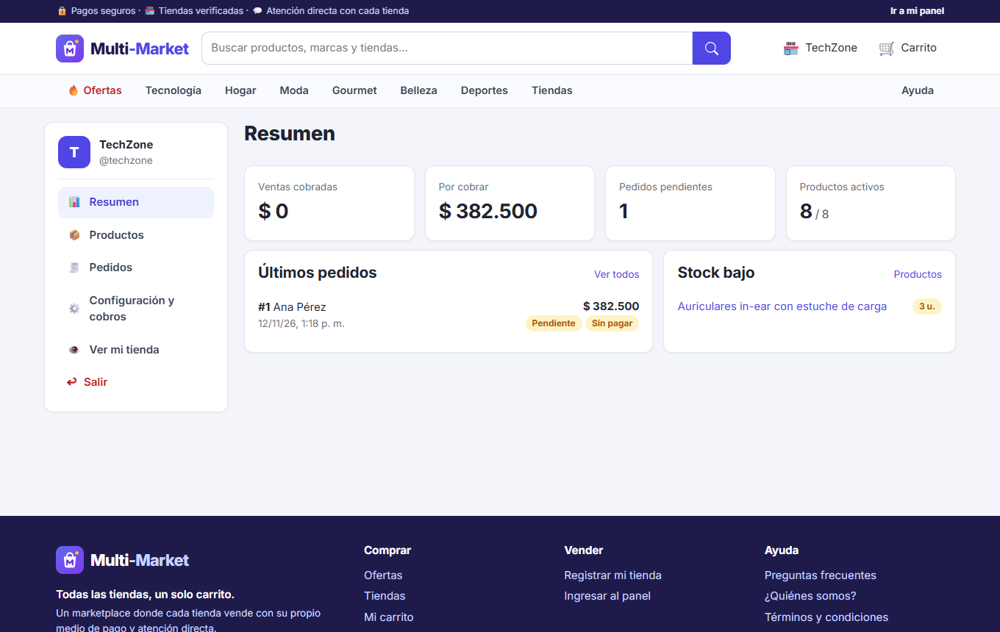 | 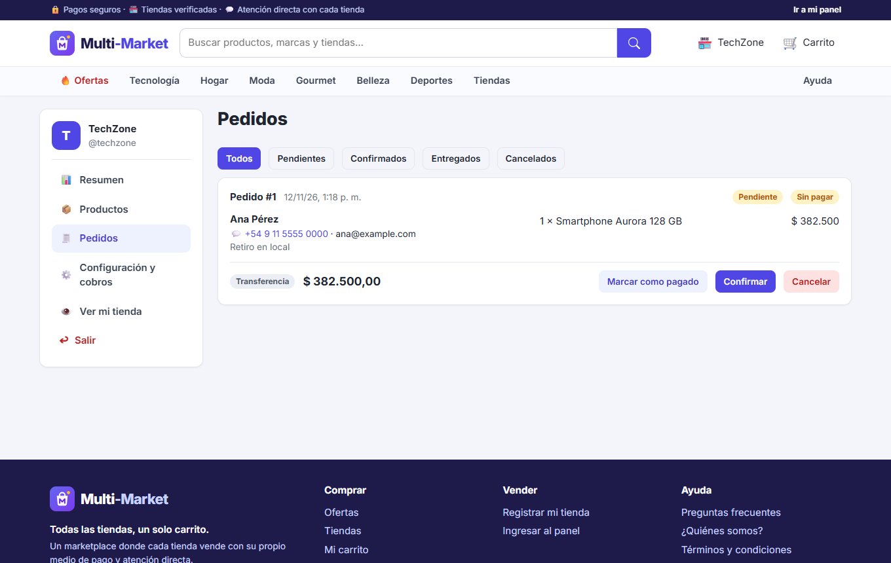 |
| Ventas cobradas, por cobrar, pedidos pendientes y stock bajo. | Confirmar, entregar, cancelar y marcar pagos manuales. |

| Productos | Configuración y cobros |
|---|---|
| 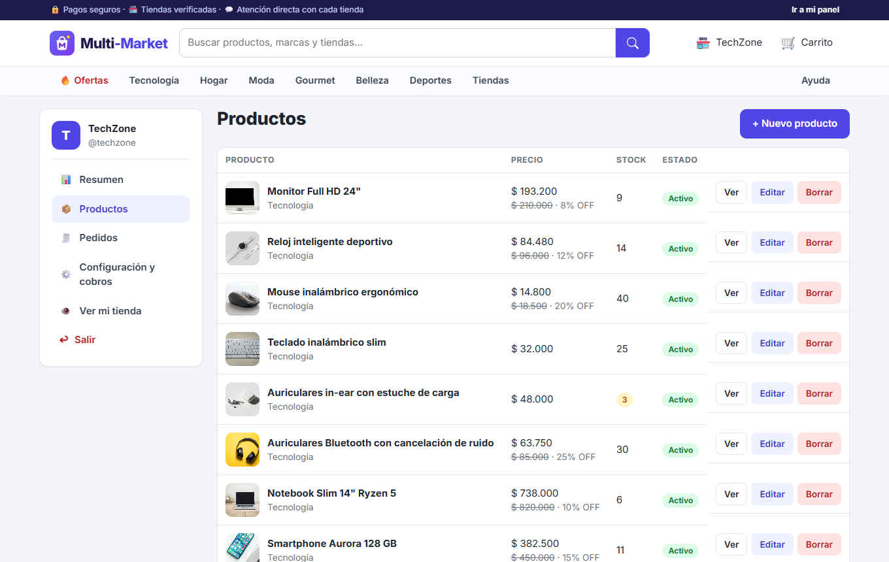 | 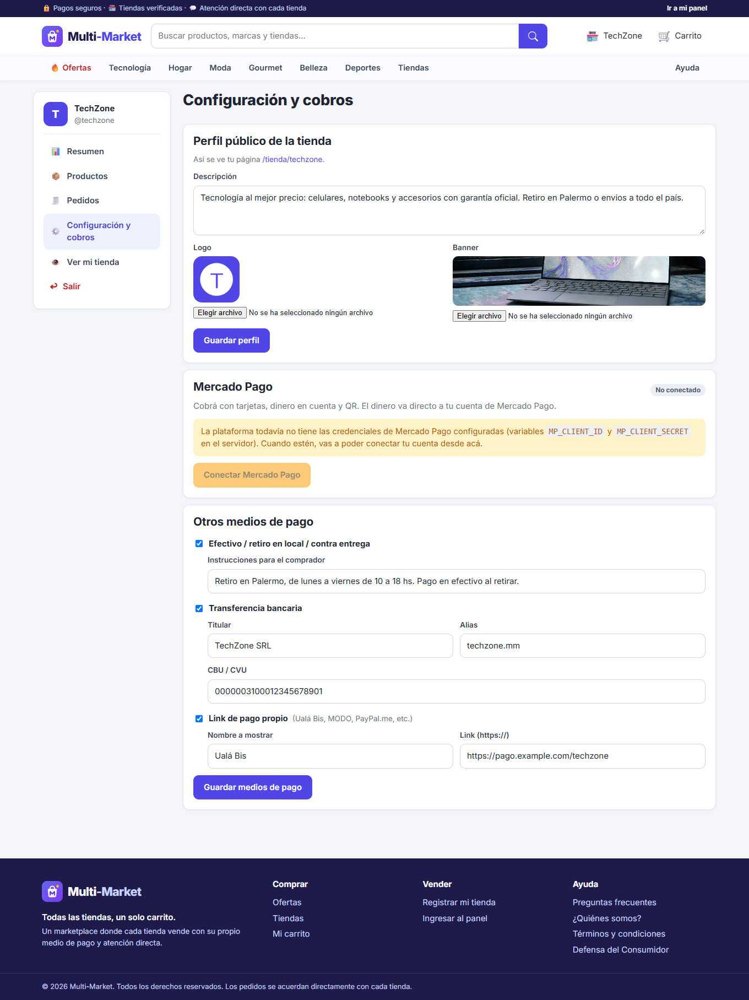 |
| Alta/edición con varias imágenes, stock y descuentos. | Perfil público, Mercado Pago, transferencia, efectivo/retiro y link de pago. |

<p align="center">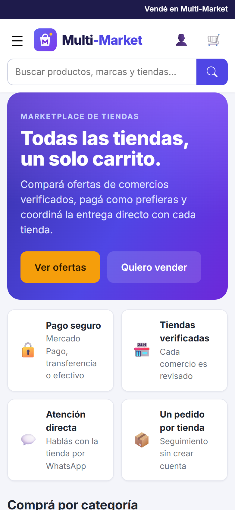 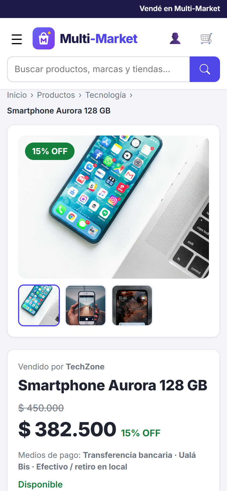</p>

> Capturas tomadas con los datos de `seed_demo` (fotos de [Unsplash](https://unsplash.com/license), ver `backend/demo_assets/CREDITS.md`).
> Se regeneran con `docs/screenshots/take-screenshots.js` (Playwright; requiere backend en `:8010` y frontend en `:8081` con datos de `seed_demo`).

## Arranque local

Requisitos: Python 3.11+ y Node 18+.

```bash
# Backend (http://127.0.0.1:8000)
cd backend
python -m venv .venv && source .venv/bin/activate      # Windows: .venv\Scripts\activate
pip install -r requirements.txt
python manage.py migrate
python manage.py seed_demo                              # 6 tiendas y 38 productos con fotos (opcional)
python manage.py createsuperuser                        # para /admin/ (opcional)
python manage.py runserver

# Frontend (http://localhost:8081) en otra terminal
cd frontend
npm install
npm run serve
```

Tiendas de demo (tras `seed_demo`): `techzone`, `casabella`, `urbanstyle`, `cafeco`, `bellapiel`, `fitzone` — contraseña `demo12345`. Login en `/ingresar`.
Si el backend corre en otra URL: `frontend/.env.development` → `VUE_APP_API_URL`.

Tests del backend: `cd backend && python manage.py test`.

## Configuración (variables de entorno del backend)

Ver `backend/.env.example`. Principales: `DJANGO_SECRET_KEY` (obligatoria con `DJANGO_DEBUG=False`),
`DJANGO_ALLOWED_HOSTS`, `CORS_ALLOWED_ORIGINS`, `DB_ENGINE`/`DB_*` (MySQL/Postgres), `SQLITE_PATH`.
MySQL: `pip install -r requirements-mysql.txt`.

## Despliegue con Docker

```bash
export DJANGO_SECRET_KEY="$(python -c 'import secrets;print(secrets.token_urlsafe(50))')"
docker compose up --build        # frontend en :8080, API en :8000
docker compose exec backend python manage.py createsuperuser
```

Para producción: poner `DJANGO_ALLOWED_HOSTS`, `CORS_ALLOWED_ORIGINS` y `VUE_APP_API_URL` con tus dominios (HTTPS),
usar una base de datos gestionada y un almacenamiento externo para `media/`.

## Seguridad

Ya no hay credenciales en el repositorio. **La contraseña de MySQL y la `SECRET_KEY` anteriores quedaron en el
historial de Git: considerá rotarlas.**

## Licencia

Ver `LICENSE`.
